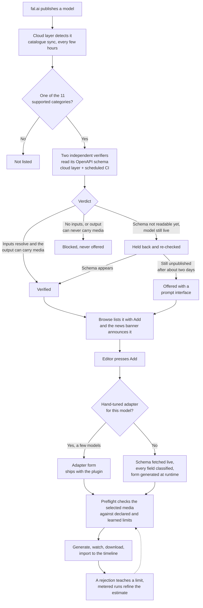

# Architecture

How modelBridge is built — design principles, current state, and development practices.

---

## System Design

modelBridge is a three-layer system: a Premiere Pro panel, a local media processing backend, and a cloud operations layer. The panel handles UI and user interaction. The backend handles media extraction, uploads, and downloads. The cloud layer monitors the AI model catalog, manages licensing, and delivers remote updates.

The layers are built to fail separately. Losing the cloud layer stops neither editing nor generation: the panel runs on its last catalogue, verdicts and licence check (for up to 14 days offline). The local backend restarts itself after a crash. What generation genuinely needs is the local backend and fal.ai itself, and when either is missing the panel says which.

The cloud layer runs autonomously — detecting new models, verifying their schemas and deciding which ones the panel may offer, without manual intervention.

---

## Core Design Principles

**Adaptive.** Almost every model gets its interface generated at runtime from its own OpenAPI schema — no per-model code. A model that is live on fal.ai but whose schema stays unpublished is still offered, with a prompt-only interface, and upgrades itself to the full form once the schema appears. A small number of models carry a hand-tuned interface that ships with the plugin (one model family today). All three paths end in the same place: a generation form the editor can use. This is how 1,296 installable models (the panel's catalogue count, measured 2026-10-21) across 11 supported image, video, and audio generation or transformation categories are supported without plugin updates — and how a model that launched this morning is usually something an editor can run this afternoon, rather than something that waits for our next release. That is the difference between a live catalogue and a curated partner list, and it is the only claim here worth making.

**Usage-calibrated.** The plugin learns from usage. When a model rejects media, the constraint is remembered and enforced automatically on future attempts. Cost estimates improve as your metered usage accumulates. Generation time estimates appear after a few uses and converge toward your actual experience the more you generate.

**Resilient.** User data survives cache clears, application updates, and plugin reinstalls. Automatic backup before every migration of installed-model data. Silent recovery when primary storage is unavailable. No "start over from scratch" scenarios.

**Remotely updatable.** Error handling, endpoint changes and feature flags are delivered over-the-air. When something changes in the AI ecosystem, the response ships without a plugin release and without user action; the manifest carries a one-hour cache, read at panel start, so it reaches an editor the next time they open the panel. Model intelligence arrives the same way from the plugin's own cloud service rather than the update channel, and curated pricing corrections travel neither today: they ship bundled in a plugin release. The panel would accept a remote pricing file only if the update manifest pinned its hash, and the manifest pins none, so a cost estimate cannot currently be changed remotely.

**Defensive.** All external data is parsed defensively — invalid values are rejected before they reach business logic. Validation runs before every generation to prevent wasted API credits.

---

## Model Discovery & Availability

modelBridge continuously monitors the AI model ecosystem. When a provider launches a new model, the system detects it automatically — no one adds it by hand, and no plugin release is involved.

**The cadence, stated rather than promised.** The cloud layer wakes every two hours and runs one of three phases in rotation — discover, validate, publish — so each phase comes round about every six hours. A scheduled check in CI reads every schema in the catalogue twice a day on top of that. A new model therefore has to be seen, then verified, then published, and what an editor sees adds a CDN hop and the panel's own catalogue cache. For a model whose schema verifies, that is same-day rather than same-hour, because the honest bound is the sum of those steps, not the interval of any one of them. A model whose schema is not published takes longer — see below.

**Two verifiers, one verdict.** Every model in the 11 supported categories is read by two independent verifiers: the cloud layer, and the scheduled CI check. Both fetch the model's OpenAPI schema and require a real input schema with concrete types. The CI check also reads the output schema and refuses a model whose output can never carry a file URL — a live stream, an id, a paragraph of text — because a supported category is not evidence about the output. When the two disagree, a model the cloud layer has verified stays available unless CI proves it cannot run; an inconclusive CI result never withdraws it. The verdict is one of four:

| Verdict | When | What the editor sees |
|---|---|---|
| **Verified** | the schema resolves with real inputs, and the output can carry media | listed in Browse with **Add**, announced in the news banner |
| **Held back** | the model is listed on fal.ai but its schema cannot be read yet (not published, failed to expand, behind authentication) | not offered yet; re-checked automatically |
| **Prompt interface** | still held back after repeated checks over about two days, still listed on fal.ai, and not behind authentication | listed with **Add**; installs as a prompt plus the media input its category implies (an image for image-to-video, none for text-to-image), and upgrades to the full form once the schema appears |
| **Blocked** | proven incompatible: no inputs, an output that can never carry a file, or excluded by hand | never offered |

A typed search can also reach a model neither verifier has seen yet. Its schema is then checked at the moment the editor presses Add, and the same refusals apply there: the panel itself re-reads the schema, so no verdict from the cloud is the last word.

**What happens at Add.** If the model has a hand-tuned adapter, the adapter is used and no schema is fetched. Otherwise the schema is fetched live — fal.ai's queue API first, the platform API as a fallback, the last good copy if both are down — and every input is classified and rendered (see *The schema is the interface* below). A prompt-interface install happens only after the panel has itself confirmed that the schema is unavailable; a transient failure fails the add loudly rather than installing a degraded form.

**What "no plugin update needed" covers.** Everything on the automatic path — new models, their parameters, the verdicts, the prompt interface and its upgrade — reaches an installed panel without a release. Hand-tuned adapters are panel code: a new one ships in a release, and an existing one can be switched off remotely.

---

## Scale

| | |
|---|---|
| Supported AI models | 1,296 installable models (measured 2026-10-21) across 11 supported image, video, and audio generation or transformation categories — see the Coverage note in [README.md](README.md) |
| Panel codebase | About 229,000 lines of JavaScript and CSS (counted 2026-10-23), plus the ExtendScript host layer and the local backend |
| Design system | Token-driven — visual consistency across every surface |
| Documentation site | About 90 pages across guides, reference, Academy, and legal (counted 2026-10-21), plus a parameter index generated from the live catalogue |
| Automated tests | A harness of offline suites and live-panel (CDP) suites, run by one command that writes the run as an artefact; a pre-commit guard refuses any published test count that does not come from that artefact, so no figure is copied by hand — which is also why none is printed here. Plus catalogue audits and end-to-end import tests against a live Premiere |
| Built by | One developer — structured for team onboarding and handover (documented conventions, migration plan, and test suites) |

---

## Development Practices

**Structured documentation.** The project includes extensive internal documentation — architecture overviews, system deep-dives, convention guides, and behavioral rules. This documentation follows a structured format that is consumable by both human developers and AI coding agents, enabling a new developer to orient within the codebase using standard tooling.

**Test coverage.** Automated test suites validate the critical paths: error normalization and translation across all fal.ai error formats, cost estimation accuracy across 11 pricing formula types, dual-mode input synchronization and field aliasing, parameter override behavior, visual rendering consistency, and pricing supplement parsing. End-to-end scripts cover a live generation through polling to preview, and timeline import across four scenarios (insert, video replace, image replace, audio replace). A catalog-wide classification audit runs every model through the schema parser; a separate field-mapping audit has verified widget classification across 10,000+ input fields.

**Conventions and rules.** Coding conventions, commit standards, and architectural rules are documented and enforced consistently. Every error must go through the translation layer — no raw API output reaches users. Every data migration must create a backup first. Every bug fix must check for the same class of problem elsewhere in the codebase.

**Release process.** Cloud updates follow a review workflow with integrity verification (SHA-256 checksums) before deployment. Plugin releases ship as a macOS `.pkg` installer with version-tracked changelogs.

---

## Platform Integration

### fal.ai

modelBridge integrates with fal.ai at multiple API levels — not just the generation endpoint.

**Model catalog.** The plugin consumes fal.ai's model listing and search APIs (authenticated with the editor's own key when one is set), its category classification, and its per-model schema endpoints. The Trending order in Browse is not a fal.ai signal: it comes from a public model leaderboard, matched to the catalogue by modelBridge's cloud layer. The catalog is treated as a live data source, not a static list — new models, schema changes, and retirements are detected and handled automatically. Why the architecture is built on this catalogue rather than a hand-picked subset is set out in [Why fal.ai](https://docs.modelbridge.app/why-fal-ai/).

**Schema parsing.** Every model's OpenAPI specification is fetched, parsed, and used to generate the complete UI — input fields, validation rules, media requirements, and parameter constraints. The plugin supports both fal.ai's queue API and platform API endpoints, with automatic fallback between them.

**Pricing.** Cost estimates draw on three sources only: fal.ai's official pricing API, a curated pricing table that ships with the plugin, and the editor's own metered history. Nothing is scraped, and no endpoint outside fal.ai's official API is asked about prices.

**Error specification.** The plugin parses both of fal.ai's error response formats — structured validation errors (Format A) and infrastructure errors (Format B) — including `ctx` structured constraint data, error documentation URLs and the `X-Fal-Retryable` header. The documented error types map to specific user-facing copy; an unrecognised type falls back to a generic message rather than raw output. Five semantic categories (INPUT_QUALITY, CREDITS_BILLING, NETWORK_RETRY, CONTENT_POLICY, DEVELOPER_BUG) drive consistent visual treatment across all error surfaces. When a billing error and an input error arrive together, both reach the banner — the second as a line under the first — so one does not hide the other.

**Resilience to API changes.** The schema-driven architecture absorbs changes in fal.ai's catalogue without code changes: a new model, and every parameter it declares, needs no release. Schema fetching falls back from the queue API to the platform API to the last good copy, so a temporary API issue never blocks the user. A renamed endpoint is migrated to its new id, and a retired one is confirmed absent from the catalogue before anything is removed.

### Consuming the fal.ai API in production

The section above lists what modelBridge integrates with. This one is the engineering account of consuming it — where the API's own shape sets the terms of the integration, and what was built to meet them. Numbers carry the date they were produced; **measured** means observed in a live run or against a captured corpus, as opposed to read from documentation.

**The schema is the interface.** Every generation form is rendered from the model's OpenAPI document — the automatic path has no per-model UI code, so the document is not an input to the UI, it *is* the UI. The working corpus behind the numbers here is 1,497 schema responses captured through the plugin's own fetch path — 14,025 input properties — of which 11,523 fields across 1,143 models were reachable in the shipping catalog when the render snapshot was taken (2026-08-06). Those fields resolve to a closed set of widget kinds in 35 widget-by-placement combinations, and the catalog's media-input space collapses to 26 distinct shapes — combinations of required and optional image, video and audio inputs (swept 2026-08-13). None of these sets is static: a new shape arrives with the first model that carries it, announced by nothing except the schema itself, which is why the shape sweep is a rerunnable script rather than a table in a document.

Most of a form derives cleanly — types, enums, numeric ranges, defaults, required flags, media roles. Two properties of the corpus have to be met deliberately:

- **Nullability is an idiom, not a type.** 1,963 fields across roughly 70 % of models express "optional" as OpenAPI 3.0's `anyOf: [{type:"string"}, {type:"null"}]` rather than a scalar type (measured 2026-08-06). A consumer that matches only scalar `type` values loses all of them in a single day if the catalog ever serializes as OpenAPI 3.1, where the same fields become `type: ["string","null"]` — an array. The classifier is therefore written to fail loud rather than open: an unrecognized construct renders as an explicitly labelled fallback field, never as a silent bare text box, so its failure mode is a visible field rather than a paid-for malformed request.

- **Schemas change with no revision marker.** A schema can change underneath an installed model, and nothing in the document announces it — change detection is the consumer's job. Installed endpoints are re-checked against the catalogue daily, and a renamed endpoint is migrated with its form rebuilt from the new schema. A schema that changes under an *unchanged* endpoint is not re-detected in the current build: the daily check moved from fetching schemas to reading the catalogue on 2026-08-27, and the drift comparison went with it. A model added after the change gets the new form, and a normalized shape baseline captured 2026-08-06 exists so a later capture has something to diff against.

**How a schema becomes a form.** What the classifier does with a field, described by what it decides rather than how:

- **Declared type before name.** Enums, booleans, numbers and `*_prompt` fields are classified from their declared type first; a field name decides only where the type cannot. `video_output_type` is a dropdown, never an upload.
- **Two readings of every model.** fal.ai's category drives the Browse badge and filters; the schema alone drives the form. When they disagree — a category promising a video input the schema does not have — the form follows the schema and the disagreement is recorded for review instead of being resolved silently.
- **Media roles and card layouts.** Start and end frames, masks and reference sets are recognised from the schema, and the catalogue's media inputs map onto a small set of card layouts: a single input, a start/end pair, a reference-image set, several separate media fields.
- **Unions, conditionals and mixed enums.** An `ImageSize | preset` union becomes a preset-or-custom size picker. An enum mixing strings and numbers (`["auto", 5, 6, …]`) sends the list's own value back with its declared type. OpenAPI `if/then` requirements are evaluated against the values the editor has set, so a field is required only when its condition holds.
- **Nested structures.** Arrays of objects and nested objects render as sub-forms; a media field inside one never counts as the model's main input.
- **Output checked before Add.** A model whose output schema can never carry a file URL is refused before the editor can install it.
- **Limits from three places.** Machine-readable `x-fal` constraints first, then limits stated in the description prose, then limits learned from a rejection, which fill gaps and never override a declared value.

Some things do not derive at all. 18 of the 1,497 schemas declare no inputs. Some constraints exist only as prose in field descriptions; the preflight reads the common phrasings of dimensions, aspect-ratio ranges and durations out of that prose, and what it cannot read is learned from the first rejection (see media constraints below). The hand-tuned adapters and the streamlined prompt-only interface described earlier exist for exactly the models where the automatic path cannot deliver the whole form.

**A status word is not the whole status.** The queue API reports IN_QUEUE, IN_PROGRESS, COMPLETED, FAILED. The edge, measured live on 2026-08-15 from two real requests: a terminal failure can be reported on a status other than FAILED. One request was still reported as IN_PROGRESS two days after submission, with `inference_time: 0.0` and a runner-acquisition failure sitting in its `error` field the entire time; the other reported COMPLETED with `error_type: "runner_disconnected"` and no result URL. A consumer that reads "not terminal" as "still running" renders "Generating…" forever on the first and retries a result fetch forever on the second — which is what this plugin did before the measurement, and is the incident the following machinery comes from.

- **Failure is concluded only from provider evidence.** The first rule derived from those two payloads ended a run on any error field. It was withdrawn on 2026-09-14: an error field on an in-flight status can describe a runner problem fal.ai recovers from, and ending a run that is still live is the worse mistake. Today a run fails on an explicit FAILED, on a COMPLETED whose result URL refuses, or on a status endpoint that refuses the request three times running; three minutes of lost contact ends the watch and points to the fal.ai dashboard. A request stuck like the first payload is watched until the editor cancels it.
- **An unknown status renders as unknown, never as progress.** Status words map to progress stations through one fixed vocabulary, and a value outside it is shown as unknown rather than painted as motion (shipped 2026-08-16).
- **"Generating" carries a freshness requirement.** A running generation that has gone too long without an understood response flips to an explicit checking state showing when contact was last confirmed. Progress is a claim backed by a recent, understood answer, not by the absence of a terminal one.
- **No clock ends the wait.** A run is watched for as long as it is running on fal.ai — there is no fixed deadline, because a long video run can legitimately outlast any deadline we would pick. A watch ends when the run finishes, when the editor cancels, or after three minutes of unbroken lost contact; the last two point at the fal.ai dashboard, because the charge may be real even when delivery is not, so the terminal state names where the authoritative record lives. A run interrupted by a Premiere restart resumes watching on the next panel open, within 24 hours of last contact and 72 hours of submission. *(Corrected 2026-10-21: this bullet described a 30-minute wall. No such deadline exists in the shipping code; 30 minutes is only the scale of the progress display.)*
- **"Not sent" and "unconfirmed" are different answers.** A run that ended before anything reached fal.ai — a refused upload, a failed extraction, a declined warning — is shown as "Not sent" and never counts as spend. A submission that fal.ai never confirmed with a request id is booked as *unconfirmed* and marked "Charged?" in Billing, because the request may have been accepted. Storage uploads are bounded by stall rather than by a clock: an upload is abandoned only after 30 seconds with no bytes moving, and the panel's wait follows the backend's progress heartbeat, so a large file on a slow line is not cut off mid-transfer — and an upload the panel loses track of is booked as unconfirmed, never as "Not sent".
- **Cost settles after the fact.** A cancelled run, a failed run without a usage count, or a success that arrived without one is re-read from fal.ai at start-up and when Billing opens, for up to six days, and is priced from the count fal.ai then reports.
- **`X-Fal-Retryable` is read and carried, not yet obeyed.** The header is parsed onto every normalized error, but the retry decision still comes from the error type's own classification. Making the provider's verdict the deciding input is open work.

**The dollar is a derivation, and every label says whose.** What the API emits about money is precise but partial. `x-fal-billable-units` on a result is a quantity — never a dollar. `GET /v1/models/pricing` is a per-unit rate. The identity `cost = units × unit price` reproduced fal.ai's own arithmetic in all four metered runs, across three model classes, in which it was tested (2026-08-25), fractional quantities included. But the unit is the model author's own convention, with no cross-catalog rule to lean on — measured the same day: one video family normalizes resolution into the quantity (the same second of output bills a different unit count at 720p than at 1080p), another books usage in token blocks, and the same model reached through an endpoint alias is a separate pricing row in a third unit. Quantity follows the nominal request, not the delivered output (a 5-second request bills as 5 seconds even when the delivered clip runs a fraction longer). The function from parameters to units — the thing a pre-run estimate actually needs — is not machine-readable anywhere: the rate is published; the quantity rule is not.

The product's cost labels map one-to-one onto what the provider handed over for that specific number:

| Label | Backed by |
|---|---|
| **Metered $X** | fal.ai reported a usage quantity for this run — the dollar is that quantity × the known rate |
| **Calculated $X** | the run finished without a quantity modelBridge can price — the dollar is modelBridge's own formula |
| **Estimated $X** | pre-run, from curated per-model pricing |
| **Learned ≈$X** | pre-run, the median of your own metered history for these exact settings |
| **From $X** | pre-run, fal.ai's published base rate — a floor, not a prediction |
| **No price** | no source qualifies, so no number is shown |
| **Metered / Calculated (failed run)** | post-run — the run failed, but fal.ai reported usage for it or reported it completed, so it is counted as spend |
| **Charged, amount unknown** | post-run — fal.ai reported usage in a unit modelBridge has no rate for, so the count is shown and no amount |
| **Charged?** | Billing only — the submission was never confirmed with a request id, so a charge is possible and not proven |

About 61 % of the active catalog (856 of 1,392, measured 2026-07-24) prices in a unit that converts to a per-output figure and can carry a "From $X" floor; the rest fall back to curated pricing or the editor's own metered history where either exists, and otherwise show "No price" rather than an approximation. No label in the product presents a figure as fal.ai's invoice: fal.ai reports a usage quantity, never a per-request dollar, so every dollar shown is that quantity × modelBridge's rate, or modelBridge's own formula. And when the pricing API omits its `unit` field, the absence is treated as unknown and falls to "No price" — an earlier version defaulted the missing field to per-request, which silently repriced per-second models as flat-rate, and that class of confident wrong number is exactly what the labelling discipline exists to make impossible.

**What the panel knows before you spend.** Selected media is validated against the model's declared limits continuously while a clip is selected — dimensions, duration, file size, aspect ratio — and a failing clip is refused with the reason on the thumbnail ("Video too long (21.6 s, max 20 s)") before any request leaves the machine. The ceiling on that is what schemas declare, and the machine-readable constraint vocabulary is small and unevenly used. The extractor reads the dimension, duration, file-size and aspect-ratio keys the `x-fal` vocabulary provides; the corpus also carries a few further keys on a handful of schemas that are not yet consumed. On a 58-model reference install (2026-08-20), 4 of the 41 media-taking models declared any machine-readable limit at all; the rest enforce their limits server-side, in prose, or not at all.

The mitigation is that a rejection teaches. When a generation fails validation, the structured constraint data in the error is read, and the limit is stored per model and enforced at preflight from then on: the same clip against the same model is refused client-side next time, before spend. The learner is deliberately narrow — only validation-class errors can teach it (a billing or infrastructure error never can), and a learned limit fills a gap under a declared one, never overrides it. `ctx` is the part of the error contract that makes this loop dependable: it is machine-readable where the message is prose, and it is the reason the same mistake does not cost money twice.

This section is about what the API demands. How often we ask of it — poll volume per generation and the backoff behind it, the catalogue synchronisation cadence and what that cadence costs in freshness, and the same accounting for the other two services modelBridge depends on — is in [`PERFORMANCE_AND_LOAD.md`](PERFORMANCE_AND_LOAD.md), together with the panel-side measurements and the findings we got wrong.

### Agent Mode

Agent Mode is a natural-language layer on top of modelBridge's Premiere Pro integration. Editors describe what they want in plain language; the agent reads the timeline, plans the operation, executes edits, and reports back.

Agent Mode runs on the user's own Claude API key, but it isn't a general chatbot bolted onto Premiere. modelBridge adds a layer built to tailor the agent for Adobe's environment:

- **Wired into the Premiere toolkit.** It reads timelines, edits clips, runs quality checks, and delivers, all from plain language.
- **Knows where Premiere's scripting stops.** When an operation is outside what Premiere's scripting can do, the agent says so and gives the manual step, instead of improvising with a tool that only looks equivalent.
- **Checks its own work.** Timeline-shape edits are re-read from the real timeline after they run, and when a change can't be confirmed the agent says so instead of reporting success.
- **Honest by design.** It says plainly when something genuinely can't be done, and never guesses at a cause it can't see.
- **Reports its own coverage.** Tools that sample rather than read everything return how much of the request they covered — counts of what was expected against what was produced, plus named lists of what was never opened and what could not be read. The schemas instruct the model that a confident verdict over an unread item is a false claim. A truncated result otherwise looks exactly like a complete one, which is the failure mode this closes.
- **Cannot spend money by itself.** A generation requested in chat is staged, not started: inputs resolved against the model's schema, validated, and returned with a cost estimate. Firing it requires a button the agent can only ask for, and the click re-checks that the model and the media are still the ones that were approved — refusing rather than re-binding if either drifted. The gate is code on the click path, not an instruction in a prompt.

The result: Agent Mode finishes the work a raw model would hand back to the user, and is plain about the part Premiere does not allow.

**What Agent Mode can do today.** Timeline introspection, clip editing (move, trim, split, delete), property adjustment (scale, position, opacity, speed, Lumetri), effect and transition management, track and sequence operations, LUT scans and batch color operations, multi-platform export (Instagram / TikTok / YouTube / Twitter / X / LinkedIn / Facebook), environment-aware silence analysis — measurement, a keeper-range cut list, and on the editor's go-ahead a new sequence assembled from those ranges with per-range readback, the working sequence left untouched — quality-control inspection, and direct handoff into modelBridge generation flows for AI-driven edits.

**Available models.** Claude Haiku 5.5 (default, fast + cheap) and Claude Sonnet 5.5 (deeper reasoning). Editors can switch at any point in a conversation.

**Privacy.** Conversations are sent directly to Anthropic's API using the editor's own key. modelBridge does not store, log, or relay conversation content. No conversation data transits modelBridge infrastructure. Absolute media paths are replaced with opaque, session-scoped references at a single choke point before anything is sent and resolved back locally on return — session-scoped by construction, so the reference does not itself identify the file across sessions. The project file's own path is handled the same way. Filenames still travel, because the agent has to name the clip, and three kinds of path travel as written: a path the editor types into the chat, anything inside raw XMP text, and the candidates of a disk search for an offline file. The boundary is stated in the source rather than implied, and in full in [PRIVACY_AND_COMPLIANCE.md](PRIVACY_AND_COMPLIANCE.md) §6.

### Adobe Premiere Pro

modelBridge is a deep Premiere Pro integration, not a standalone panel that happens to run inside the application.

**Timeline interaction.** The plugin reads and writes to the active sequence — clip selection, track identification, In/Out points, playhead position, and sequence metadata. Generated media is placed on the correct track, at the correct timecode, with frame-accurate positioning. An extend-video result that confidently matches the timeline clip it was made from is placed as only the new footage, directly after that clip on the same track; otherwise it imports like any other result. When an image model needs a still and a video is selected, a camera button (**Capture frame**) captures the frame at the playhead into the model's image input; its hover text names the timecode it will take.

**Source Monitor.** Results can be opened directly in Premiere Pro's Source Monitor for full-resolution evaluation. Editors can set In/Out points in the Source Monitor and import only the selected range.

**Media awareness.** The plugin reads clip properties from the timeline — dimensions, duration, file path, track index — and uses them for validation, media extraction, and context-aware import decisions (replace in-place vs. insert at playhead vs. route to audio track).

**ExtendScript bridge.** A host layer of a few hundred global ExtendScript functions handles communication between the panel and Premiere Pro's scripting engine — covering clip selection, sequence queries, project bin management, timeline manipulation, and fit-to-frame scaling. Host communication is being consolidated behind an adapter layer: 82 % of host calls routed through it (2026-10-21; 75 % on 2026-08-30 by the same search), with the agent layer fully converted and the generation pipeline deliberately left until after launch. See [UXP_MIGRATION.md](UXP_MIGRATION.md) for the full measurements, including what the adapter layer does *not* cover.

---

## Operational Infrastructure

The cloud operations layer is deployed on an edge runtime and runs continuously, around the clock. It is stateless by design; all persistent state lives in a plain key-value store.

**Failure recovery.** If the cloud layer is unavailable, the panel continues operating with cached data — the catalog, pricing, and model intelligence all use stale-while-revalidate strategies. When the cloud layer recovers, data refreshes silently in the background.

**Monitoring.** The cloud layer sends instant operator alerts for urgent licensing and catalogue events, and a daily summary of customers, usage and health. A separate scheduled CI job sends the daily catalogue digest: new, verified, held-back and removed models.

**Local backend recovery.** The Node.js backend on localhost includes health monitoring, automatic restart on crash (up to three attempts), keep-alive pings, and port conflict detection. If the backend is unreachable after all recovery attempts, the panel surfaces a clear status message with a manual restart option.

### Self-running systems inventory

The following systems operate autonomously — reducing manual maintenance and keeping the plugin current between releases.

**Catalog pipeline.** The cloud layer watches the full fal.ai catalog around the clock. New models are verified before they reach the panel — a model with a broken or unpublished spec is held back and re-checked automatically, and promoted at the next check after it becomes usable. Verification runs from two places — the cloud layer itself, and a scheduled catalogue check in CI twice a day — and when they disagree, a model the cloud layer has verified stays available unless the CI check proves it cannot run or finds its specification behind an authentication wall; an inconclusive CI result does not withdraw it. Models that disappear from fal.ai are confirmed over multiple checks before being marked gone, a pass in which more than half the catalogue vanishes is treated as an API fault rather than a mass removal, and a model that returns is listed again automatically.

**Plugin-side health checks.** Installed models are re-checked quietly in the background — at start-up and then daily, two at a time, pausing while the editor is choosing a model — without ever blocking. Renamed endpoints are migrated silently and their form rebuilt from the new schema. A model is treated as removed only when it is absent from a *complete* catalogue on two consecutive checks; it is then surfaced with a one-click cleanup, and removed automatically after a week if it stays gone. A partial catalogue never convicts anything.

**News feed.** New models in the supported categories are announced automatically — once they can actually be added, not when they are first seen. The plugin displays these as compact banners with a "Today" badge and one-click install. The feed also carries manual entries (feature updates, maintenance notices, tips) published by the operator.

**Operator notifications.** The operator gets daily digests of customer activity, catalog movement, and pipeline health, with instant alerts for anything urgent. Quiet days collapse to a single line — length itself is the signal.

**OTA updates.** Error documentation, error message templates and endpoint migrations are delivered over-the-air from a remote manifest. Each control is named per channel rather than claimed across all of them:

- **The file payloads are pinned.** Every file the manifest declares carries a SHA-256, verified before the payload is applied. A mismatch, a missing pin, a panel that cannot compute the hash or an unreachable file rejects the payload, and the last verified copy — or, on a fresh install, the one bundled in the extension — serves instead. The channel fails closed, never open.
- **Remote configuration is constrained, not pinned.** The config file that carries incident banners, kill switches and per-model validation modes is not hash-verified. It is bounded instead: schema sources must match an exact host allowlist, and only the kill switches the channel itself declares may be set, so it cannot reach a flag it does not own.
- **Feature flags ride in the manifest body**, which carries no hash of itself. What protects them is that the manifest is served from a repository only we can write to — the same trust root as the pins, stated plainly rather than implied by the sentence above.

**Self-learning validation.** When a model rejects media for a requirement its spec never declared — dimensions, file size, duration, aspect ratio — modelBridge remembers the limit and enforces it before the next attempt, on the media card and, for duration, in the form. The lesson is kept on disk as well as in the panel, so it survives a cache clear, and you're told once, the first time, that it was learned.

**Cost learning.** Estimates sharpen from your own usage — after a few generations with a model, your real metered costs refine the estimate for exactly the settings you use. A learned estimate that goes unused long enough retires rather than going stale.

**Generation time learning.** After a few generations with a model, its card shows a time estimate based on your own runs — and it keeps converging toward your actual experience.

**Background generation recovery.** If Premiere Pro restarts during an active generation, recovery data persists locally. On next panel open, watching resumes automatically with the original request ID; a recovery bar with a status check appears only for a run whose watch had already stopped.

**Model insights enrichment.** Editor-focused highlights for each model are generated in the cloud, cached locally, and refreshed quietly in the background — every model card tells you what the model is actually good at, in an editor's terms.

**Capability badges.** Model cards show what a model can do — HD, 4K, audio, LoRA support, extendable duration. Resolution is derived from the model's own spec, and extendable duration reads the spec first and a curated table second, so new models mostly arrive labelled without a manual list. Two badges are not yet spec-derived everywhere: on one surface the audio badge reads curated pricing data, and LoRA support falls back to the model's name.

**License revalidation.** Licences are verified server-side with signed snapshots. Status is re-checked every 12 hours while the panel is open and at start-up when the last check is over a day old, and each new generation confirms its seat with the licence service; if the licence service cannot be reached, the plugin keeps working for 14 days since the last successful check, and never answers an unreachable service by asking for the licence key again. Trial countdowns, a failed renewal while the payment provider retries, and other status transitions are handled without user action. Each of the 13 licence states that needs the customer's attention — from an expired trial to a refunded order — reads the same wording on Generate, Agent and Settings, from one shared copy table.

**Exchange rates.** Cost displays support multiple currencies with live rates from a public API. Fallback defaults are used when the API is unreachable. Historical rates are stored per generation for accurate retrospective reporting.

**Thumbnail backfill.** Models without preview images are backfilled lazily in the background — concurrency-capped, non-blocking, with smooth transitions in the UI.

**Visibility-aware polling.** When the panel is hidden, non-critical background work pauses automatically. Generation polling, the backend keep-alive and a few bounded housekeeping tasks continue; everything else waits.

**Anonymous error telemetry.** Unrecognized errors produce anonymous reports (error type and source from a fixed list, HTTP status, whether it was retryable, plugin and Premiere version, platform — no message text, model, prompt, path, URL, key, timestamp or personal data). This is how new error types are discovered for documentation. Off by default — enabled only if you opt in from Settings.

**Support infrastructure.** Hundreds of curated parameter explanations (hand-written, not auto-generated) provide contextual help via ⓘ icons. A field that has no curated explanation yet still gets a working ⓘ, linked to its entry in a parameter index on the docs site that is rebuilt from the live catalogue — so a new model's settings are explained from the day it arrives, and the curated text follows. Dozens of documented error codes link to structured troubleshooting pages. Context-aware validation templates interpolate exact constraint values into error messages. Academy articles appear as contextual links on model cards — only when relevant to the selected model.

---

## Data Architecture

All user data — saved models, settings, generation history, cost logs, and learned constraints — is stored locally on the user's machine. None of it is stored on modelBridge servers. Generated media is downloaded directly from fal.ai to a local project folder.

The cloud operations layer stores catalog state (model availability, schema verification status) and licensing state (subscription status, device identifiers). It does not store user-generated content, prompts, API keys, or personal information beyond what is provided during license activation — or in a bug report or rating you explicitly choose to send.

API keys are stored locally and transmitted only to their own provider directly — the fal.ai key to fal.ai, the Anthropic key to Anthropic — never to modelBridge infrastructure. Anonymous error telemetry (error type, HTTP status, plugin and Premiere version) is off until the user turns it on, and can be turned off again at any time.

Full data architecture, retention policies, and third-party data flows are documented in the [Privacy Policy](https://docs.modelbridge.app/legal/privacy-policy/).

---

## Security & Privacy

User API keys are stored locally and used exclusively for direct communication with their own provider (fal.ai, and Anthropic for Agent Mode) — they never transit modelBridge infrastructure. The update channel is read-only and carries no user data.

A licence check carries the information needed to validate product access and support device management, including a device name made of the platform, the processor model and a random four-character tag (for example "macOS · Apple M2 Pro · 3f9a"). Since 2026-09-27 the device name no longer contains the computer's network name; a device activated by an earlier build keeps its old name, which did, until it is activated again. The service returns the subscription status and access information needed by the product. Licence checks are not used to transfer creative project content.

The local backend binds the loopback interface only and is not exposed to the network. Optional error reporting is off by default and carries technical error context, filtered and truncated before it is sent. Optional usage measurement is opt-in only.

For full data inventory, GDPR compliance measures, subprocessor list, and retention policies, see [PRIVACY_AND_COMPLIANCE.md](PRIVACY_AND_COMPLIANCE.md).

Comprehensive privacy coverage — including GDPR, CCPA, LGPD, UK GDPR, and AI Act positioning — is published at [docs.modelbridge.app/legal/privacy-policy/](https://docs.modelbridge.app/legal/privacy-policy/).

---

## Scalability

modelBridge is a client-side application — each installation runs its own panel and local backend. There is no shared server infrastructure that becomes a bottleneck as the user base grows.

**Panel and backend.** Run locally per user. Scaling is linear — each new user is an independent instance with no shared state.

**Cloud operations layer.** Runs on an edge runtime with automatic geographic distribution. Catalog monitoring and schema verification are read-heavy workloads against fal.ai's public APIs, bounded by the size of the catalog (1,296 installable models on 2026-10-21), not by the number of modelBridge users.

**OTA delivery.** Served from a global CDN. Static files, no compute per request. Scales to any number of users without infrastructure changes.

**Known limits.** Background generations queue at the fal.ai API level, not locally. The primary scaling constraint is fal.ai's own API rate limits, which apply per user API key. Current scale and functional constraints are documented in [Known Limitations](https://docs.modelbridge.app/reference/limitations/).

---

## Dependencies & Licensing

### Proprietary code

The modelBridge codebase — panel JavaScript, CSS design system, cloud operations worker, schema parsing engine, cost estimation system, error handling pipeline, and all documentation — is proprietary. A small set of Premiere Pro control tools used by Agent Mode is vendored from the open-source `leancoderkavy/premiere-pro-mcp` project (MIT); see [NOTICE.md](NOTICE.md) for attribution.

### External service dependencies

| Dependency | Role | License / Terms |
|---|---|---|
| fal.ai API | AI model generation, schema, pricing, catalog | Commercial API — user authenticates with their own key |
| LemonSqueezy | Subscription billing, license validation | Commercial SaaS — webhook integration |
| GitHub raw content | OTA delivery — error docs, error copy, endpoint migrations (each SHA-256 pinned); remote config and feature flags (host- and switch-allowlisted, not pinned) | Public CDN — read-only, no user data sent |

### Local runtime dependencies

| Dependency | Role | License |
|---|---|---|
| Node.js + Express | Local backend server | MIT |
| FFmpeg / FFprobe | Media extraction (video frames, audio, metadata) | LGPL — bundled as LGPL-only builds, invoked as external processes |
| Sharp | Image processing (thumbnails, format conversion) | Apache-2.0 |
| libvips | Image processing library used by Sharp | LGPL-3.0-or-later (dynamically linked, user-replaceable) |

FFmpeg and FFprobe ship with the plugin as **LGPL-only builds** — compiled without the GPL and non-free components, verified from the build configuration of each binary — and are invoked as separate processes, never linked. libvips is dynamically linked and user-replaceable. Complete attributions, licence texts and build provenance ship with the plugin. All other runtime dependencies are permissively licensed.

The macOS binaries are built from source rather than downloaded, and the build is a deliberately small one: `--disable-everything` with an explicit allowlist of demuxers, decoders, encoders, muxers and filters, `--disable-autodetect`, and **`--disable-network`** — leaving `file` and `pipe` as the only two protocols compiled in. That bundled macOS binary has no network code in it at all.

**The guarantee is about that binary, not about every ffmpeg the product may end up running,** and the distinction is worth stating precisely because it is the kind that gets rounded off. Two cases fall outside it. No Windows build ships today — the product is macOS-only — and when one does, its binaries are planned as a downloaded LGPL release build rather than one we compile, a general-purpose build with network protocols present. And if the bundled binaries are missing, the backend falls back to a copy already installed on the machine — the user's own ffmpeg, built by someone else, about which no build claim can be made. Each binary's origin, full configure string and SHA-256 are recorded in `bin/ffmpeg-provenance.json`, which ships inside the extension, so which case you are in is checkable without trusting this document.

In every case ffmpeg is invoked on local file paths only, as a separate process, and nothing in the product asks it to open a URL. The narrower claim — that the macOS build *cannot* reach the network even if asked — holds for the bundled macOS build alone. See [NOTICE.md](NOTICE.md) for the linked libraries these builds carry.

### Proprietary components

- UI rendering and schema-driven interface generation
- Field classification and input parsing
- Cost estimation engine
- Self-learning validation system
- Error translation and handling pipeline
- OTA update infrastructure
- Cloud operations worker (catalog monitoring, insights, licensing)
- All documentation pages

---

## Platform Roadmap

Adobe is transitioning Premiere Pro extensions from CEP to UXP. modelBridge is designed with this migration in mind — not as a future project, but as an active constraint on all current development.

**Migration plan.** A detailed migration plan is in place, covering interface contracts, an API parity mapping between ExtendScript and UXP equivalents, and a phased timeline. Adapter layers isolate platform-specific code where that is possible — three surfaces (path construction, external URLs, credential storage) are at zero remaining direct calls; host calls are at 82 %; file I/O at 56 % by acquisition site, all measured 2026-10-21. One surface has no adapter at all: 400 `localStorage` calls across 55 files (2026-10-21; 384 across 50 on 2026-09-01), which UXP does not provide.

**It is a reconstruction, not a port, and three parts of it cannot be adapted at all.** UXP can launch a process but cannot pass it arguments or read its output, so the local backend — 13 of whose routes invoke FFmpeg or FFprobe — has to become a separately installed companion application. The panel's 146 script tags (counted 2026-10-21; 114 on 2026-08-30) must become a bundle. At least 22 user-facing timeline operations depend on Premiere's unsupported QE DOM, with no supported equivalent today (counted 2026-08-19). Our own parity table maps 23 of about 380 host functions, about 6 % (2026-10-21). The full measurements, the open questions to Adobe, and the places our own early decisions were wrong are in [UXP_MIGRATION.md](UXP_MIGRATION.md).

**The support window, as Adobe states it.** Adobe's PProPanel sample documentation records that CEP extensions were superseded by UXP as of Premiere Pro 25.6, and that the plan is to support both "for a calendar year, after which we will remove support for CEP extensibilty." No end date has been published. We plan against the short reading of that range rather than the long one.

**CEP works in Premiere Pro 26.3.2, measured 2026-09-01.** A widely-linked bug report against a different extension claims CEP extensions no longer load in Premiere 2026. We ran the full chain against 26.3.2 — panel loads, backend spawns, a generation completes, the result imports to the timeline through the ExtendScript bridge — and all four steps work, which makes that report an installation-path problem rather than a platform removal. This is one version on one platform: support can be withdrawn in a point release, and a version that still loads CEP is not a commitment that the next one will. It removes a false alarm; it does not extend the window. On 2026-10-21 the development panel was running in Premiere Pro 26.5.1.

**Migration-first development policy.** New code follows migration-aware rules: file system access through a storage abstraction, Premiere Pro communication through the host adapter, no new direct platform calls. The policy also requires new storage and host APIs to be async-first, matching UXP's async model even though CEP allows synchronous calls — and the storage adapter itself was built synchronous, in violation of that rule, which turns its eventual replacement into a signature change at every call site.

**How much of that policy is actually enforced, measured 2026-08-30.** This paragraph previously said the rules were "enforced on every contribution". They are not, and the measurement is unambiguous: seventeen new direct file-system calls entered the panel in the eleven days after the last audit. About thirty commit guards run on every commit today (seventeen on 2026-08-30), and none of them is a general guard on direct platform calls. What exists is one *subsystem-scoped* guard — the newest layer in the tree is mechanically prevented from touching the file system or the host outside a single named adapter file, which is why that layer did not drift. So the honest statement is: the policy is written down, one subsystem enforces it mechanically and stays clean, and everywhere else it depends on the author remembering. Both our own errors here — the synchronous storage adapter, and a 384-call-site `localStorage` dependency we were not counting at all — are reported in [UXP_MIGRATION.md](UXP_MIGRATION.md) alongside what the policy did buy.

**Planned modernization.** Introducing a module bundler (prerequisite for UXP — UXP does not support the current script-tag loading model), running the panel's test suites in CI (today CI runs the catalogue verification, the ExtendScript ES3 guard, the dual-mode offline suites and the parameter-coverage and docs-link checks, not the whole harness), and incremental type annotations.

For the product roadmap (Agent Mode expansion, Team Cost Intelligence, Enterprise features), see [ROADMAP.md](ROADMAP.md).

---

## Working With the Codebase

The internal documentation follows a structured format that is consumable by both human developers and AI coding agents, enabling a new developer to orient within the codebase using standard tooling. Opening the project in Claude Code, Cursor, or a similar tool gives the agent access to the full project documentation, behavioral rules, and architectural context automatically. Questions about any system, pipeline, or design decision can be answered by the agent directly from the project files.

---

## Further Reading

- [What is modelBridge](https://docs.modelbridge.app/what-is-modelbridge/) — product overview and comparison
- [Schema-Driven UI](https://docs.modelbridge.app/features/schema-driven-ui/) — how the adaptive interface works
- [Cost Estimation](https://docs.modelbridge.app/models/costs/) — confidence tiers and pricing sources
- [Self-Learning Validation](https://docs.modelbridge.app/reference/self-learning/) — how constraints are learned and enforced
- [Error Handling](https://docs.modelbridge.app/troubleshooting/how-errors-work/) — translation pipeline and user-facing messages
- [Privacy Policy](https://docs.modelbridge.app/legal/privacy-policy/) — full data architecture, GDPR/CCPA/LGPD compliance
- [Terms & Conditions](https://docs.modelbridge.app/legal/terms-and-conditions/) — IP, liability, AI Act positioning
- [Compatibility](https://docs.modelbridge.app/reference/compatibility/) — supported platforms and requirements
- [Known Limitations](https://docs.modelbridge.app/reference/limitations/) — honest list of current constraints
- [Privacy & Compliance](PRIVACY_AND_COMPLIANCE.md) — data inventory, GDPR measures, subprocessor list
- [Roadmap](ROADMAP.md) — Team Cost Intelligence, Agent Mode expansion, Enterprise features
